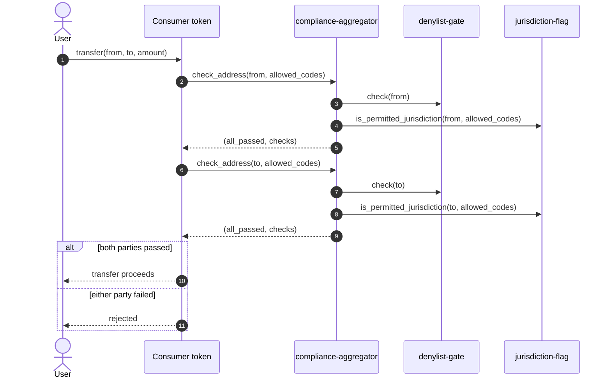
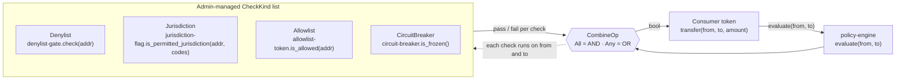
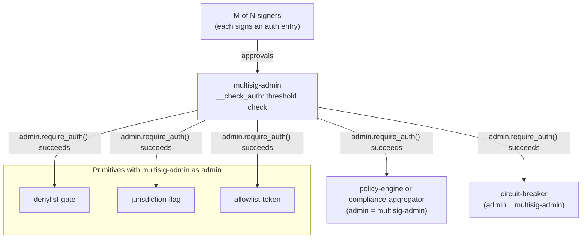

# How Primitives Compose

This page shows three common ways to wire the compliance primitives into a
token, with a Mermaid diagram for each. [`ARCHITECTURE.md`](../ARCHITECTURE.md)
lists what each contract is; this page shows how they call each other at
runtime. For which primitives to pick, see
[`PRIMITIVE_SELECTION_GUIDE.md`](PRIMITIVE_SELECTION_GUIDE.md).

Every link in these diagrams is a cross-contract call, except `pausable`,
which is compiled into each primitive and never appears as a runtime call.

## Setup 1: Token → Aggregator → Checks

The consumer token asks `compliance-aggregator` for a verdict on each party.
The aggregator calls `denylist-gate` and `jurisdiction-flag` and AND-combines
the results. Use this when you want the fixed two-check shape and the fewest
moving parts. See [`examples/rwa-token-aggregator`](../examples/rwa-token-aggregator).

The aggregator only AND-combines its two checks. If you need the aggregator to
be paused or frozen as well, register a `circuit-breaker` with
`set_circuit_breaker`; `check_address` honours it.

## Setup 2: Token → Policy Engine → Checks

The consumer token makes one call to `policy-engine.evaluate(from, to)`. The
engine runs an admin-managed list of checks against both addresses and combines
them with `All` (AND) or `Any` (OR). Use this when the check list must change
without a redeploy, or when you need OR logic. See
[`examples/circuit-breaker-policy-engine`](../examples/circuit-breaker-policy-engine)
and [`examples/policy-engine-audit`](../examples/policy-engine-audit).

`evaluate` returns a single `bool`. Use `evaluate_verbose` when you need to
know which check failed, for example in an audit log.

The `CircuitBreaker` check is the only one that does not look at an address.
It fails the whole policy while the breaker is frozen.

## Setup 3: Multisig Admin

Every primitive takes an `admin` address at `initialize` time (`allowlist-token`
takes it alongside the wrapped `token`). Setting that address to a
`multisig-admin` contract, instead of a single key, means every admin call
needs M-of-N signer approval. No primitive code changes are needed. See
[`DESIGN_MULTISIG_ADMIN.md`](../DESIGN_MULTISIG_ADMIN.md) and
[`examples/multisig-governed-allowlist`](../examples/multisig-governed-allowlist).

Each admin-only call (for example `denylist-gate` add or remove, or
`jurisdiction-flag` set or remove) reaches `require_auth` on the admin address.
That re-enters `multisig-admin.__check_auth`, which needs `threshold` signer
approvals. The primitive itself does not know the admin is a multisig.

Check the threshold before you go live. A 1-of-N setup is a single key with
extra steps.

## Choosing a setup

| If you need | Use |
|---|---|
| Denylist and jurisdiction checks, fixed shape, minimal moving parts | Setup 1 (aggregator) |
| Check list that changes at runtime, or OR logic, or a freeze check inside the policy | Setup 2 (policy engine) |
| Any admin action to need more than one signer | Setup 3 (multisig admin), combined with either setup above |

Setups 1 and 2 are alternatives: they do the same job at different levels of
flexibility. Setup 3 is orthogonal and can wrap either one.
